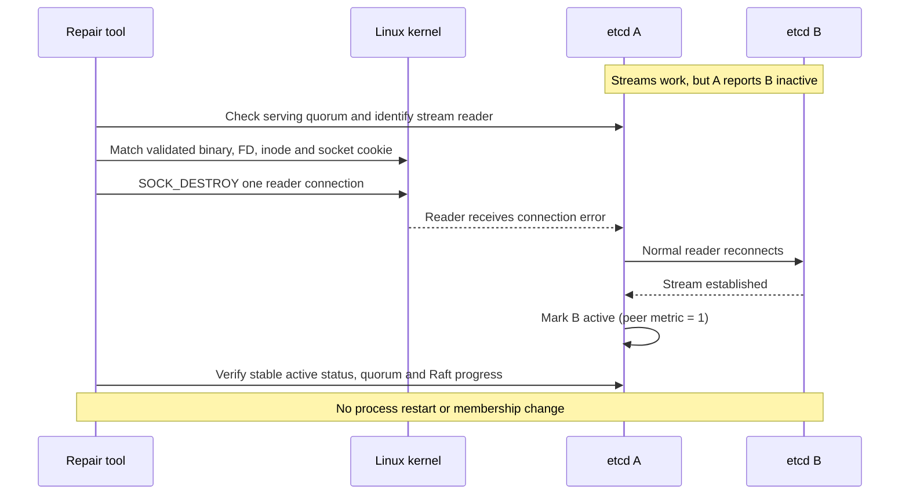

# Repair latched etcd peer status

When a member reports a serving peer inactive despite working streams, this tool
closes one identified MsgApp v2 reader connection. Etcd reconnects normally and
marks the peer active again. This works around the status latch, not its TLS or
transport trigger.



[Rendered diagram](mechanism.png)

## Safety

- Requires a validated executable hash/architecture and a healthy voting quorum,
  including both selected members. An unavailable third member is allowed.
- Rechecks process/member identities and the selected socket before closing it.
  The kernel matches its connection tuple and socket cookie.
- At most one socket close per invocation, with no automatic close retry. This
  briefly interrupts that stream; no process, Pod, membership, PVC or recovery
  setting is changed.
- Saves an audit before requesting the close, then verifies active status and
  quorum progress for at least ten seconds by default.

## Usage

Run on the affected member's Linux host as root, with Python 3.6+, `crictl` and
`nsenter`. Access to `/proc/PID/mem`, mounted client TLS credentials, etcd's
status/health/metrics/goroutine endpoints and `SOCK_DESTROY` is required.
No Kubernetes CLI is used.

Check the [collector](../collector/README.md) package against supported binaries:

```sh
python3 etcd_peer_repair.py check-support \
  --collection report.json --binary etcd-executable
```

Inspect without changing connections. Replace the uppercase placeholders, using
the **current remote member ID**, not a removed member's metric series:

```sh
sudo python3 etcd_peer_repair.py inspect \
  --runtime-endpoint unix:///run/crio/crio.sock \
  --namespace NAMESPACE --pod LOCAL_POD --peer-id REMOTE_MEMBER_ID \
  --report inspect-001.json
```

Review the support, eligibility, identities and candidate socket in the report.
Then repair with the verified cluster and local member IDs (all IDs are hex):

```sh
sudo python3 etcd_peer_repair.py repair \
  --runtime-endpoint unix:///run/crio/crio.sock \
  --namespace NAMESPACE --pod LOCAL_POD --peer-id REMOTE_MEMBER_ID \
  --expect-cluster-id CLUSTER_ID --expect-member-id LOCAL_MEMBER_ID \
  --report repair-001.json
```

Use a new report filename each time. Success is `reconnected_and_verified`;
`already_active_no_action` means no close was needed. If the outcome is
`close_requested_verification_incomplete`, inspect the audit and current cluster
state before attempting anything further. Use `--help` for TLS/endpoint overrides.
